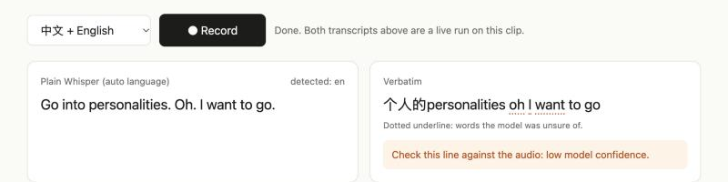

# Verbatim: catching speech-to-text that silently translates bilingual speakers

**Track:** AI + Languages

## The problem
Many bilingual people mix two languages in one sentence. Speech-to-text sometimes doesn't write down what they said. It writes a fluent translation instead. In one real clip, "那你有没有什么favourite foods" ("do you have any favorite foods?") came out of Whisper as **"That you have no favorite food?"**, a different sentence with the opposite meaning, that reads perfectly fine. As transcripts become records (AI-scribe visit notes, voicemails, captions), errors like this go unnoticed. About 27 million people in the US have limited English proficiency ([KFF](https://www.kff.org/racial-equity-and-health-policy/issue-brief/overview-of-health-coverage-and-care-for-individuals-with-limited-english-proficiency/)).

## What we built
**For:** a scribe, clinician or family member reading a transcript of a bilingual speaker, who needs to know which lines to check against the audio.

**In:** audio of mixed Mandarin–English (or Spanish–English) speech. **Out:** a transcript that keeps the speaker's mix of languages, with a flag and reasons on lines to re-check.

1. **Fine-tuned transcriber.** Whisper's decoder, trained on 8,387 real code-switched Mandarin–English clips.
2. **Cross-checks.** Regular Whisper decodes the same clip three ways: auto-detect, Mandarin forced + mixed-language prompt, and English forced + mixed-language prompt.
3. **Choose and flag.** Broken versions are dropped (loops, impossible word rate, wrong script, empty output), and the most confident version is kept. The line is flagged when the model is unsure, when the versions disagree, or when a third language is detected.
4. **Mark the words.** Inside each line, the words the model was least sure of are underlined, so the reader knows where to listen.
5. **Demo:** speak a sentence, or replay a real test clip, and see plain Whisper next to Verbatim (`demo/`).

*A real test clip. The speaker said "个人的personalities还有那个". Verbatim's line is still wrong, and it says so: the line is flagged and the invented words are underlined.*

## What we added
Our own idea, closest to suggested project 4.4.3. We added our own question (translation instead of transcription), a blind hand-labeled answer key by a native Chinese reader on our team, a fine-tuned fix plus a review flag, and a second unseen dataset with a second language pair.

## How it works
- **Data:** [ASCEND](https://huggingface.co/datasets/CAiRE/ASCEND), real Mandarin–English conversation (CC BY-SA 4.0).
  - Train: 8,387 clips.
  - Validation: 210 mixed clips.
  - Test: 369 mixed clips.
  - Speakers are different in each split.
- **Unseen second test:** [ServiceNow asr_codeswitched](https://huggingface.co/datasets/ServiceNow-AI/asr_codeswitched), synthetic speech: 294 Mandarin–English and 259 Spanish–English clips.
- **Model:** [Whisper large-v3-turbo](https://huggingface.co/openai/whisper-large-v3-turbo).
  - Decoder fine-tuned with the encoder frozen: 800 steps × 8 clips, about 2.5 hours on an M3 laptop.
  - Cross-checks run with [mlx-whisper](https://github.com/ml-explore/mlx-examples/tree/main/whisper).
- **Fair testing:** every threshold and model choice was made on validation and saved with a timestamp before the test set was scored once. There were two early looks at test data: a pilot on 80 test clips before the method existed, and one printout of error rates by language group while designing v1. The saved settings are in `data/thresholds_*_frozen.json`.
- **Word marks:** a word is underlined when its token log-probability is below −0.60, a cut-off chosen on validation and saved before the test set was scored.
- **Measures:**
  - Mixed error rate (MER): total edits (substitutions, deletions, insertions) divided by total reference tokens, counting Chinese characters and English words.
  - Blind labels: a native Chinese reader labeled 347 transcripts in two rounds, with the systems shuffled and unnamed. Re-labeling 71 plain-Whisper lines matched the first round on 69.

## Results (ASCEND test, held out)
| | Plain Whisper (baseline) | Verbatim |
|---|---|---|
| Mixed error rate, 369 clips | 23.3% | **12.3%** (47% fewer errors, CI 33–62%) |
| Mixed error rate, all speech: the same 369 plus 584 single-language clips | 20.4% | **12.4%** |
| Lines fully correct, human-judged (70 random) | 26 (37%) | 28 (40%) |
| Lines silently translated, human-judged (70 random) | 8 (11%) | 7 (10%) |
| Human-confirmed translations no longer translated | — | 13 of 21 |
| **Flags that pointed at a real error (70 random)** | — | **11 of 11 (CI 74–100%)** |
| Real errors flagged (70 random) | — | 11 of 42 (26%) |
| Flags that pointed at a real error (all 99 labeled lines, including 29 picked as likely translations) | — | 25 of 28 (89%) |
| **Underlined words that were wrong (369 clips, against the reference)** | — | **196 of 347 (56%, CI 51–62%)**; 1 word in 10 is wrong overall |

**What this means:** fine-tuning brings transcripts much closer to what was said. But a native speaker still found an error in most lines, from either system, because most fixed lines go from badly wrong to slightly wrong. The flag is precise but quiet: when it flags a line, there is almost always an error, but it flags about a quarter of the errors. The underline works the same way one level down: an underlined word is wrong more often than not, and 37% of all wrong words are underlined.

**Both test speakers improved:** 34.1% → 17.2% and 17.4% → 9.7% (the test set has two speakers, neither heard in training).

**It does not break ordinary speech.** The same speakers also say sentences with no mixing, and a transcriber sees those too. On 414 Mandarin-only test clips the error rate went from 15.2% to 10.0%, and on 170 English-only clips from 26.0% to 21.3%. Plain Whisper wrote 9 Mandarin-only clips mostly in English; Verbatim did that on 3.

**By language** (MER, plain → Verbatim):
- Mandarin–English real speech: 23.3% → 12.3%.
- Mandarin–English synthetic: 6.6% → 7.7%.
- Spanish–English synthetic: 6.6% → 6.3%. Verbatim fixed both of plain Whisper's Spanish→English translations, without fine-tuning.

**Clean synthetic speech hides the problem:** plain Whisper translated 0 of 294 synthetic Mandarin clips, but 8% of real ones.

**Where it fails:**
- **Short phrases at language switches** still get translated. "就是hard choice" became "this is hard choice."
- **Writing style.** On synthetic speech, the fine-tuned model writes numbers as Chinese characters ("ID七四零五六一七"), so its score is worse even though the meaning is right.
- **When every version makes the same mistake,** nothing is flagged. "使用这个function的时候" became "使用这个方向的时候" everywhere.
- **Spanish flags** pointed at no real errors (0 of 11).
- **English-only speech gets flagged a lot** (44% of lines), because the model is less sure there. 60 of those 75 flagged lines did have an error.

More tables and examples are in [RESULTS.md](RESULTS.md).

## What we'd do next
1. Fine-tune on a mix of real code-switched sources, including Spanish–English conversation, and train harder on short switch-point phrases.
2. Test with real clinic conversations from bilingual patients, with their permission.

## Sources
- **Datasets:**
  - ASCEND, Lovenia et al. 2022 ([paper](https://arxiv.org/abs/2112.06223), [data](https://huggingface.co/datasets/CAiRE/ASCEND)).
  - ServiceNow-AI [asr_codeswitched](https://huggingface.co/datasets/ServiceNow-AI/asr_codeswitched).
- **Models and libraries:**
  - OpenAI [Whisper large-v3-turbo](https://huggingface.co/openai/whisper-large-v3-turbo) and its [mlx-community conversion](https://huggingface.co/mlx-community/whisper-large-v3-turbo).
  - [mlx-whisper](https://github.com/ml-explore/mlx-examples/tree/main/whisper).
  - Hugging Face [Transformers](https://github.com/huggingface/transformers) and [PyTorch](https://pytorch.org).
  - [OpenCC](https://github.com/yichen0831/opencc-python), pandas, soundfile, soxr.
- **Prior work:**
  - ServiceNow AI, [code-switching ASR benchmark](https://huggingface.co/blog/ServiceNow-AI/code-switching) (2026).
  - Peng et al. 2023, [prompting Whisper](https://arxiv.org/abs/2305.11095).
  - Whisper on ASCEND, [arXiv 2510.18724](https://arxiv.org/abs/2510.18724).
- **AI tools:** [Claude Code](https://claude.com/claude-code) (Anthropic) helped write code and analysis.

How to run everything: [RESULTS.md#reproduce](RESULTS.md#reproduce). Requirements: an Apple Silicon Mac, Python 3, and FFmpeg (for the demo's microphone audio). The fine-tuned weights (1.6 GB) are not in the repo; `scripts/finetune.py` rebuilds them in about 2.5 hours, and the demo runs without them using the regular Whisper decodes.

The result files in `data/` include reference transcripts from ASCEND (CC BY-SA 4.0, shared under the same license) and ServiceNow asr_codeswitched. Seven short ASCEND test clips are included in `demo/audio/` for the demo (same license). Other audio and the model weights are not included.
